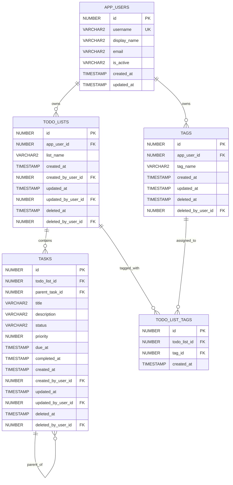

# TaskHub POC — מסמך אפיון טכני

**גרסה:** 2.0  
**Database:** Oracle Database 19c+  
**Future UI:** Oracle APEX  
**Implementation target:** Codex  
**Purpose:** Proof of Concept בלבד

---

## 1. מטרת המערכת

`TaskHub` היא מערכת POC קטנה לניהול רשימות משימות.

לכל משתמש אפליקטיבי יהיו מספר `To-Do Lists`.  
לכל רשימה יהיו מספר `Tags`.  
בכל רשימה יהיו `Tasks`, כאשר Task יכול להכיל Subtasks עד עומק של 3 רמות מתחת ל-Task הראשי.

המטרה המרכזית של ה-POC היא לבדוק:

- יצירת Data Model באמצעות **Oracle APEX Quick SQL**.
- מימוש API ב-PL/SQL.
- הפרדה אבטחתית בין Application Schema לבין Data Owner.
- שימוש ב-Oracle Application Context לצורך זיהוי המשתמש.
- חשיפת נתונים לקריאה דרך Views בלבד.
- Soft Delete ו-Purge חודשי.
- יכולת של Codex לממש את המערכת בשלבים.

---

# 2. ארכיטקטורה

## 2.1 Schemas

### `TASKHUB_OWNER`

זהו ה-Data Owner.

הוא יהיה הבעלים של:

- Tables
- Views
- `TASKHUB_CTX`
- `PKG_TASKHUB_CONTEXT`
- `PKG_TASKHUB_API`
- `PKG_TASKHUB_MAINT`
- `DBMS_SCHEDULER` Job

### `TASKHUB_APP`

זהו ה-Application Schema.

בעתיד הוא יהיה ה-Parsing Schema של Oracle APEX.

ל-`TASKHUB_APP` יהיו רק:

- `EXECUTE` על `TASKHUB_OWNER.PKG_TASKHUB_CONTEXT`
- `EXECUTE` על `TASKHUB_OWNER.PKG_TASKHUB_API`
- `SELECT` על Views מאושרים

לא יהיו לו הרשאות ישירות על הטבלאות.

כלומר:

```text
TASKHUB_APP
    |
    +-- EXECUTE --> PKG_TASKHUB_CONTEXT
    |
    +-- EXECUTE --> PKG_TASKHUB_API
    |
    +-- SELECT  --> READ-ONLY VIEWS
                         |
                         v
                  TASKHUB_OWNER
                         |
                         v
                       TABLES
```

---

# 3. עיקרון האבטחה

## 3.1 APP_USER_ID אינו פרמטר של CRUD

אסור להעביר `APP_USER_ID` כפרמטר לפעולות CRUD.

לדוגמה, API כזה **אינו מותר**:

```plsql
procedure delete_task (
    p_app_user_id in number,
    p_task_id     in number
);
```

הסיבה היא שה-caller יכול לנסות להעביר `APP_USER_ID` של משתמש אחר.

במקום זאת, זהות המשתמש תיקבע פעם אחת עבור ה-request באמצעות:

```text
TASKHUB_CTX.APP_USER_ID
TASKHUB_CTX.APP_USERNAME
```

וה-Package יקרא אותה באמצעות:

```sql
sys_context('TASKHUB_CTX', 'APP_USER_ID')
```

---

## 3.2 למה זה חשוב

ההחלטה הזו היא **Security Requirement**, ולא רק החלטת מימוש.

המטרות הן:

1. למנוע spoofing של `APP_USER_ID`.
2. לרכז Ownership ו-Authorization בתוך בסיס הנתונים.
3. להשתמש באותו מקור זהות עבור ה-Package ועבור ה-Views.
4. למנוע מצב שבו מפתח שוכח להוסיף predicate של משתמש.
5. למנוע גישה לנתונים של משתמש אחר גם במקרה של טעות ב-APEX.

---

# 4. APEX Application Context

יוגדר:

```text
TASKHUB_CTX
```

עם attributes:

```text
APP_USER_ID
APP_USERNAME
```

Package:

```text
TASKHUB_OWNER.PKG_TASKHUB_CONTEXT
```

ה-Package יכיל לפחות:

```plsql
procedure init_from_apex;
procedure clear_context;
```

`INIT_FROM_APEX` יקרא:

```sql
sys_context('APEX$SESSION', 'APP_USER')
```

ימפה את שם המשתמש ל-`APP_USERS.ID`, יוודא שהמשתמש פעיל, ורק אז יגדיר את `TASKHUB_CTX`.

ה-Context יאותחל **בכל APEX Request** וינוקה בסוף ה-Request.

אם אין Context תקף:

- פעולת CRUD חייבת להיכשל.
- Views חייבים להחזיר 0 שורות.

---

# 5. ERD



---

# 6. Quick SQL — כללי עבודה

המודל ייווצר תחילה באמצעות **Oracle APEX Quick SQL**.

Quick SQL הוא ה-source הראשוני ליצירת ה-DDL, אבל ה-DDL שנוצר חייב לעבור review והשלמות על ידי Codex.

## Quick SQL Settings

יש להגדיר ב-Quick SQL:

```text
Primary Key          : Identity Column
Primary Key Name     : ID
Compatibility        : Oracle Database 19c
PL/SQL API           : Off
Date Data Type       : Timestamp
Audit Columns        : Off
```

### למה Audit Columns = Off?

אנחנו רוצים שה-Audit של האפליקציה יתבסס על `TASKHUB_CTX.APP_USER_ID`.

לכן לא נשתמש ב-audit columns האוטומטיים של Quick SQL.

עמודות ה-Audit שלנו מוגדרות במפורש במודל.

### הערה חשובה

אין צורך לכתוב `ID` ב-Quick SQL לכל טבלה.

Quick SQL ייצור את ה-Primary Key `ID` אוטומטית בהתאם ל-setting של Identity Column.

---

# 7. Table: APP_USERS

## 7.1 תפקיד

טבלת המשתמשים האפליקטיביים.

אלה **אינם Oracle Database Users**.

אין Login implementation בתוך בסיס הנתונים ב-POC.

---

## 7.2 Quick SQL

```text
app_users
  username vc128 /nn /unique
  display_name vc200
  email vc320
  is_active vc1 /nn /check Y,N
  created_at timestamp /nn
  updated_at timestamp
```

---

## 7.3 משמעות העמודות

| Column | Purpose |
|---|---|
| `ID` | Primary Key שנוצר על ידי Quick SQL |
| `USERNAME` | שם המשתמש האפליקטיבי |
| `DISPLAY_NAME` | שם תצוגה |
| `EMAIL` | Email אופציונלי |
| `IS_ACTIVE` | `Y` או `N` |
| `CREATED_AT` | זמן יצירה |
| `UPDATED_AT` | זמן עדכון אחרון |

---

## 7.4 כללים

`USERNAME` חייב להיות unique.

משתמש שאינו פעיל:

```text
IS_ACTIVE = 'N'
```

לא יקבל Context פעיל.

ב-POC לא מבצעים Soft Delete ל-`APP_USERS`.

Disable של משתמש נעשה באמצעות:

```text
IS_ACTIVE = 'N'
```

---

# 8. Table: TODO_LISTS

## 8.1 תפקיד

רשימת משימות.

לכל משתמש יכולים להיות מספר Lists.

---

## 8.2 Quick SQL

```text
todo_lists
  app_user_id /fk app_users /nn
  list_name vc200 /nn
  created_at timestamp /nn
  created_by_user_id /fk app_users /nn
  updated_at timestamp
  updated_by_user_id /fk app_users
  deleted_at timestamp
  deleted_by_user_id /fk app_users
```

---

## 8.3 משמעות העמודות

| Column | Purpose |
|---|---|
| `ID` | Primary Key |
| `APP_USER_ID` | Owner של הרשימה |
| `LIST_NAME` | שם הרשימה |
| `CREATED_AT` | זמן יצירה |
| `CREATED_BY_USER_ID` | המשתמש שיצר |
| `UPDATED_AT` | זמן עדכון |
| `UPDATED_BY_USER_ID` | המשתמש שביצע עדכון |
| `DELETED_AT` | Soft Delete timestamp |
| `DELETED_BY_USER_ID` | מי ביצע Soft Delete |

---

## 8.4 Ownership

הבעלות על List נקבעת באמצעות:

```text
TODO_LISTS.APP_USER_ID
```

`PKG_TASKHUB_API` חייב לוודא בכל פעולה:

```text
TODO_LISTS.APP_USER_ID =
TASKHUB_CTX.APP_USER_ID
```

---

# 9. Table: TAGS

## 9.1 תפקיד

Tags של משתמש.

לדוגמה:

```text
Work
Personal
Shopping
Database
Urgent
```

אותו Tag יכול להיות משויך למספר Lists.

---

## 9.2 Quick SQL

```text
tags
  app_user_id /fk app_users /nn
  tag_name vc100 /nn
  created_at timestamp /nn
  updated_at timestamp
  deleted_at timestamp
  deleted_by_user_id /fk app_users
```

---

## 9.3 Unique Rule

נדרש uniqueness ל-Tag אצל אותו משתמש.

לוגית:

```text
APP_USER_ID + TAG_NAME
```

ומומלץ שיהיה Case Insensitive.

לאחר יצירת ה-DDL באמצעות Quick SQL, Codex ייצור:

```sql
create unique index tags_uq1
    on tags (
        app_user_id,
        upper(trim(tag_name))
    );
```

---

# 10. Table: TODO_LIST_TAGS

## 10.1 תפקיד

טבלת Many-to-Many בין:

```text
TODO_LISTS
```

לבין:

```text
TAGS
```

---

## 10.2 Quick SQL

```text
todo_list_tags
  todo_list_id /fk todo_lists /nn
  tag_id /fk tags /nn
  created_at timestamp /nn
```

---

## 10.3 Unique Rule

אסור לשייך את אותו Tag לאותה List יותר מפעם אחת.

לאחר Quick SQL יש להוסיף:

```sql
alter table todo_list_tags
    add constraint todo_list_tags_uq1
    unique (todo_list_id, tag_id);
```

---

## 10.4 Security Rule

ה-Package חייב לוודא:

```text
TODO_LISTS.APP_USER_ID = TAGS.APP_USER_ID
```

וכן:

```text
APP_USER_ID = TASKHUB_CTX.APP_USER_ID
```

כלומר משתמש לא יכול לצרף Tag שלו ל-List של משתמש אחר, או להפך.

---

# 11. Table: TASKS

## 11.1 תפקיד

אותה טבלה משמשת גם ל:

```text
Task
Subtask
```

אין טבלת `SUBTASKS` נפרדת.

---

## 11.2 Quick SQL

```text
tasks
  todo_list_id /fk todo_lists /nn
  parent_task_id /fk tasks
  title vc200 /nn
  description vc4000
  status vc20 /nn /check OPEN,IN_PROGRESS,DONE,CANCELED
  priority num /nn /check 1,2,3
  due_at timestamp
  completed_at timestamp
  created_at timestamp /nn
  created_by_user_id /fk app_users /nn
  updated_at timestamp
  updated_by_user_id /fk app_users
  deleted_at timestamp
  deleted_by_user_id /fk app_users
```

---

## 11.3 Task מול Subtask

Task ראשי:

```text
PARENT_TASK_ID IS NULL
```

Subtask:

```text
PARENT_TASK_ID = TASKS.ID
```

---

## 11.4 עומק מקסימלי

העומק המותר:

```text
Task                     Level 0
|
+-- Subtask              Level 1
    |
    +-- Subtask          Level 2
        |
        +-- Subtask      Level 3
```

ניסיון ליצור:

```text
Level 4
```

חייב להיכשל.

---

## 11.5 בדיקות Parent

כאשר מתקבל `P_PARENT_TASK_ID`, ה-Package חייב לוודא:

1. ה-Parent קיים.
2. ה-Parent אינו Soft Deleted.
3. ה-Parent שייך לאותו `TODO_LIST_ID`.
4. הרשימה שייכת ל-`TASKHUB_CTX.APP_USER_ID`.
5. הפעולה אינה יוצרת Cycle.
6. העומק החדש אינו גדול מ-3.

---

# 12. Task Status

ערכים מותרים:

```text
OPEN
IN_PROGRESS
DONE
CANCELED
```

כאשר Status הופך ל:

```text
DONE
```

יש לקבוע:

```text
COMPLETED_AT = SYSTIMESTAMP
```

אם `COMPLETED_AT` עדיין `NULL`.

אם Task משתנה מ-`DONE` לסטטוס אחר:

```text
COMPLETED_AT = NULL
```

---

# 13. Priority

ה-Priority נשמר כ-Number.

```text
1 = HIGH
2 = MEDIUM
3 = LOW
```

המטרה היא לאפשר:

```sql
order by priority asc
```

ולקבל:

```text
HIGH
MEDIUM
LOW
```

---

# 14. Audit

ה-Audit הבסיסי יהיה:

```text
CREATED_AT
CREATED_BY_USER_ID
UPDATED_AT
UPDATED_BY_USER_ID
```

Soft Delete מוסיף:

```text
DELETED_AT
DELETED_BY_USER_ID
```

הערכים של `*_BY_USER_ID` ייקבעו מתוך:

```sql
sys_context('TASKHUB_CTX', 'APP_USER_ID')
```

ולא יתקבלו מה-caller.

---

# 15. Views

ה-Application Schema לא יקבל `SELECT` ישירות על Tables.

יוגדרו לפחות:

```text
V_TODO_LISTS
V_TODO_LIST_TAGS
V_TASKS
V_TASK_TREE
```

כל View יהיה:

```text
WITH READ ONLY
```

---

# 16. V_TODO_LISTS

ה-View יחזיר רק Lists של המשתמש הנוכחי.

לוגיקה:

```sql
where app_user_id =
      to_number(
          sys_context(
              'TASKHUB_CTX',
              'APP_USER_ID'
          )
      )
  and deleted_at is null
```

---

# 17. V_TASKS

ל-`TASKS` אין `APP_USER_ID` ישיר.

ה-Ownership נגזר דרך:

```text
TASKS.TODO_LIST_ID
        |
        v
TODO_LISTS.APP_USER_ID
```

עקרון ה-View:

```sql
select t.*
from tasks t
join todo_lists l
  on l.id = t.todo_list_id
where l.app_user_id =
      to_number(
          sys_context(
              'TASKHUB_CTX',
              'APP_USER_ID'
          )
      )
  and l.deleted_at is null
  and t.deleted_at is null
with read only;
```

---

# 18. V_TASK_TREE

`V_TASK_TREE` יספק תצוגה היררכית של Tasks.

הוא יכיל לפחות:

```text
TASK_ID
TODO_LIST_ID
PARENT_TASK_ID
TITLE
STATUS
PRIORITY
TASK_DEPTH
```

כאשר:

```text
TASK_DEPTH = 0..3
```

ניתן לממש באמצעות Oracle hierarchical query:

```text
START WITH
CONNECT BY
```

או recursive subquery factoring אם Codex יעדיף.

---

# 19. למה לא SQL Macro בשלב הזה

SQL Macro אינו ה-Security Boundary של ה-POC.

ה-Security Boundary יהיה:

```text
Application Context
        +
AUTHID DEFINER Package
        +
Filtered Read-Only Views
```

הסיבה היא שה-caller לא צריך לזכור לקרוא Macro מסוים כדי לקבל Security Filtering.

---

# 20. PKG_TASKHUB_API

ה-Package יהיה:

```text
TASKHUB_OWNER.PKG_TASKHUB_API
```

עם:

```plsql
AUTHID DEFINER
```

---

## 20.1 List API

מינימום:

```plsql
function create_list (
    p_list_name in varchar2
) return number;
```

```plsql
procedure update_list (
    p_list_id   in number,
    p_list_name in varchar2
);
```

```plsql
procedure delete_list (
    p_list_id in number
);
```

---

## 20.2 Tag API

```plsql
procedure add_tag_to_list (
    p_list_id  in number,
    p_tag_name in varchar2
);
```

```plsql
procedure remove_tag_from_list (
    p_list_id  in number,
    p_tag_name in varchar2
);
```

אם Tag אינו קיים אצל המשתמש, `ADD_TAG_TO_LIST` יכול ליצור אותו.

---

## 20.3 Task API

```plsql
function create_task (
    p_list_id        in number,
    p_parent_task_id in number default null,
    p_title          in varchar2,
    p_description    in varchar2 default null,
    p_status         in varchar2 default 'OPEN',
    p_priority       in pls_integer default 2,
    p_due_at         in timestamp default null
) return number;
```

```plsql
procedure update_task (
    p_task_id        in number,
    p_parent_task_id in number,
    p_title          in varchar2,
    p_description    in varchar2,
    p_status         in varchar2,
    p_priority       in pls_integer,
    p_due_at         in timestamp
);
```

```plsql
procedure delete_task (
    p_task_id in number
);
```

---

# 21. Package Security Contract

זהו חלק מחייב מה-SPEC.

`PKG_TASKHUB_API` חייב:

1. לקרוא את `APP_USER_ID` מתוך `TASKHUB_CTX`.
2. להיכשל אם אין Context תקף.
3. לא לקבל `APP_USER_ID` כפרמטר.
4. לבדוק Ownership לפני כל פעולה.
5. לא לחשוף אם ID של משתמש אחר קיים.
6. להשתמש ב-error כללי עבור:
   - ID לא קיים.
   - ID קיים אך שייך למשתמש אחר.
7. לבצע DML רק על rows של המשתמש הנוכחי.
8. לא לבצע `COMMIT`.
9. לא לבצע `ROLLBACK`.

Transaction control יהיה באחריות ה-caller.

---

# 22. Soft Delete

Soft Delete יחול ב-POC על:

```text
TODO_LISTS
TASKS
TAGS
```

Soft Delete מתבצע על ידי:

```text
DELETED_AT
DELETED_BY_USER_ID
```

לדוגמה:

```sql
deleted_at = systimestamp
```

והמשתמש יילקח מ:

```sql
sys_context('TASKHUB_CTX', 'APP_USER_ID')
```

---

# 23. Delete List

`DELETE_LIST` לא יבצע Physical Delete.

הוא יסמן Soft Delete על:

```text
TODO_LISTS
```

ועל כל Tasks הפעילים תחת הרשימה.

Associations ב-`TODO_LIST_TAGS` אינם צריכים להופיע ב-Views כאשר ה-List נמחק.

---

# 24. Delete Task

`DELETE_TASK` יבצע Soft Delete ל:

```text
Task
+
all descendants
```

כלומר אם נמחק Task אב, גם כל ה-Subtasks תחתיו יסומנו כמחוקים.

---

# 25. Monthly Purge

יוגדר Package:

```text
TASKHUB_OWNER.PKG_TASKHUB_MAINT
```

עם procedure:

```plsql
procedure purge_deleted;
```

ויוגדר Job:

```text
JOB_TASKHUB_PURGE_MONTHLY
```

באמצעות:

```text
DBMS_SCHEDULER
```

---

## 25.1 Retention

Physical Delete מותר רק כאשר:

```sql
deleted_at <
    systimestamp - interval '30' day
```

כלומר הנתונים יישמרו לפחות 30 יום.

מכיוון שה-Job רץ אחת לחודש, בפועל נתונים מסוימים עשויים להישמר יותר מ-30 יום.

---

# 26. Indexes

לאחר יצירת ה-DDL מ-Quick SQL יש להוסיף לפחות:

```sql
create index todo_lists_ix1
    on todo_lists (
        app_user_id,
        deleted_at
    );
```

```sql
create index tasks_ix1
    on tasks (
        todo_list_id,
        deleted_at
    );
```

```sql
create index tasks_ix2
    on tasks (
        parent_task_id
    );
```

```sql
create index tasks_ix3
    on tasks (
        status,
        priority,
        due_at
    );
```

```sql
create unique index tags_uq1
    on tags (
        app_user_id,
        upper(trim(tag_name))
    );
```

---

# 27. Grants

`TASKHUB_APP` יקבל:

```sql
grant execute
on taskhub_owner.pkg_taskhub_context
to taskhub_app;
```

```sql
grant execute
on taskhub_owner.pkg_taskhub_api
to taskhub_app;
```

```sql
grant select
on taskhub_owner.v_todo_lists
to taskhub_app;
```

```sql
grant select
on taskhub_owner.v_todo_list_tags
to taskhub_app;
```

```sql
grant select
on taskhub_owner.v_tasks
to taskhub_app;
```

```sql
grant select
on taskhub_owner.v_task_tree
to taskhub_app;
```

אסור לבצע:

```sql
grant select on taskhub_owner.tasks to taskhub_app;
```

או:

```sql
grant insert, update, delete
on taskhub_owner.tasks
to taskhub_app;
```

---

# 28. Full Quick SQL Model

הבלוק הבא הוא ה-Quick SQL המלא שניתן לתת ל-Codex או להדביק ב-APEX Quick SQL.

```text
app_users
  username vc128 /nn /unique
  display_name vc200
  email vc320
  is_active vc1 /nn /check Y,N
  created_at timestamp /nn
  updated_at timestamp

todo_lists
  app_user_id /fk app_users /nn
  list_name vc200 /nn
  created_at timestamp /nn
  created_by_user_id /fk app_users /nn
  updated_at timestamp
  updated_by_user_id /fk app_users
  deleted_at timestamp
  deleted_by_user_id /fk app_users

tags
  app_user_id /fk app_users /nn
  tag_name vc100 /nn
  created_at timestamp /nn
  updated_at timestamp
  deleted_at timestamp
  deleted_by_user_id /fk app_users

todo_list_tags
  todo_list_id /fk todo_lists /nn
  tag_id /fk tags /nn
  created_at timestamp /nn

tasks
  todo_list_id /fk todo_lists /nn
  parent_task_id /fk tasks
  title vc200 /nn
  description vc4000
  status vc20 /nn /check OPEN,IN_PROGRESS,DONE,CANCELED
  priority num /nn /check 1,2,3
  due_at timestamp
  completed_at timestamp
  created_at timestamp /nn
  created_by_user_id /fk app_users /nn
  updated_at timestamp
  updated_by_user_id /fk app_users
  deleted_at timestamp
  deleted_by_user_id /fk app_users
```

---

# 29. Post Quick SQL Checklist

Codex חייב להתייחס ל-Quick SQL כ-bootstrap בלבד.

לאחר generation עליו לבדוק ולהשלים:

- Identity PK לכל טבלה.
- FK constraints.
- Self FK של `TASKS.PARENT_TASK_ID`.
- Check constraints.
- Unique constraint על `TODO_LIST_TAGS`.
- Case-insensitive unique index של Tags.
- Indexes.
- Defaults / audit timestamp logic.
- Views.
- Application Context.
- PL/SQL Packages.
- Grants.
- DBMS_SCHEDULER Job.
- Test data.
- Positive tests.
- Negative security tests.

אם Quick SQL בגרסה שבה נעשה שימוש אינו מייצר Self-FK תקין עבור:

```text
parent_task_id /fk tasks
```

Codex חייב להשאיר את העמודה שנוצרה ולהוסיף את ה-FK ידנית ב-post-generation DDL.

---

# 30. Acceptance Criteria

ה-POC נחשב תקין כאשר:

1. `TASKHUB_APP` אינו יכול לבצע `SELECT` ישיר מהטבלאות.
2. `TASKHUB_APP` אינו יכול לבצע DML ישיר על הטבלאות.
3. קריאה אפשרית רק דרך Views.
4. כתיבה אפשרית רק דרך `PKG_TASKHUB_API`.
5. אין `APP_USER_ID` בפרמטרים של CRUD.
6. ללא `TASKHUB_CTX` תקף ה-API נכשל.
7. ללא `TASKHUB_CTX` תקף ה-Views מחזירים 0 rows.
8. משתמש אחד אינו יכול לראות Lists של משתמש אחר.
9. משתמש אחד אינו יכול לראות Tasks של משתמש אחר.
10. משתמש אחד אינו יכול לעדכן או למחוק Task של משתמש אחר.
11. ניסיון לנחש ID של משתמש אחר אינו חושף אם ה-ID קיים.
12. ניתן ליצור Subtask עד Level 3.
13. ניסיון ליצור Level 4 נכשל.
14. יצירת Cycle נכשלת.
15. Parent ו-Child חייבים להיות באותה List.
16. `ORDER BY PRIORITY ASC` מחזיר HIGH, MEDIUM, LOW.
17. מעבר ל-`DONE` מעדכן `COMPLETED_AT`.
18. יציאה מ-`DONE` מאפסת `COMPLETED_AT`.
19. Soft Deleted rows אינם מוצגים ב-Views.
20. Purge מוחק פיזית רק מידע שעבר את retention.
21. המימוש עובד על Oracle Database 19c+.

---

# 31. סדר עבודה מומלץ ל-Codex

## Phase 1 — Quick SQL / Data Model

Codex יקבל את בלוק ה-Quick SQL וייצר:

- Tables
- Constraints
- Indexes
- Seed data

לא להתקדם לפני שה-DDL רץ בהצלחה.

---

## Phase 2 — Security Context

לממש:

```text
TASKHUB_CTX
PKG_TASKHUB_CONTEXT
```

ולבדוק:

```text
valid user
inactive user
missing context
```

---

## Phase 3 — Views

לממש:

```text
V_TODO_LISTS
V_TODO_LIST_TAGS
V_TASKS
V_TASK_TREE
```

ולבדוק isolation בין שני משתמשים.

---

## Phase 4 — API

לממש:

```text
PKG_TASKHUB_API
```

כולל:

- Lists
- Tags
- Tasks
- Subtasks
- Ownership
- Hierarchy validation
- Soft Delete

---

## Phase 5 — Maintenance

לממש:

```text
PKG_TASKHUB_MAINT
JOB_TASKHUB_PURGE_MONTHLY
```

---

## Phase 6 — Security Tests

לבדוק במפורש:

```text
cross-user SELECT
cross-user UPDATE
cross-user DELETE
invalid IDs
missing context
subtask level 4
task cycle
```

---

# 32. Deliverables מ-Codex

Codex צריך לייצר לפחות:

```text
01_create_schemas.sql
02_quick_sql_generated_model.sql
03_post_quick_sql_constraints.sql
04_indexes.sql
05_context.sql
06_pkg_taskhub_context.pks
07_pkg_taskhub_context.pkb
08_views.sql
09_pkg_taskhub_api.pks
10_pkg_taskhub_api.pkb
11_pkg_taskhub_maint.pks
12_pkg_taskhub_maint.pkb
13_scheduler_job.sql
14_grants.sql
15_seed_data.sql
16_positive_tests.sql
17_security_negative_tests.sql
```

---

# 33. הערת Quick SQL

במסמך זה Quick SQL הוא חלק מפורש מה-SPEC.

כל טבלה מוגדרת קודם כל באמצעות Quick SQL.

ה-DDL שנוצר ממנו אינו נחשב final implementation עד ש-Codex מבצע review ומשלים את דרישות האבטחה וה-business rules.

Oracle מתארת את Quick SQL ככלי ליצירה מהירה של מודל relational באמצעות shorthand, כולל יצירת Primary Keys אוטומטיים ו-Foreign Keys באמצעות `/fk` או `/references`.

References:

- Oracle APEX — Creating Data Models with Quick SQL  
  https://docs.oracle.com/en/database/oracle/apex/26.1/apxdc/creating-data-models-quick-sql.html

- Oracle APEX SQL Workshop Guide — Using Quick SQL  
  https://docs.oracle.com/en/database/oracle/apex/26.1/aeutl/using-quick-sql.html

---

# End of Specification
