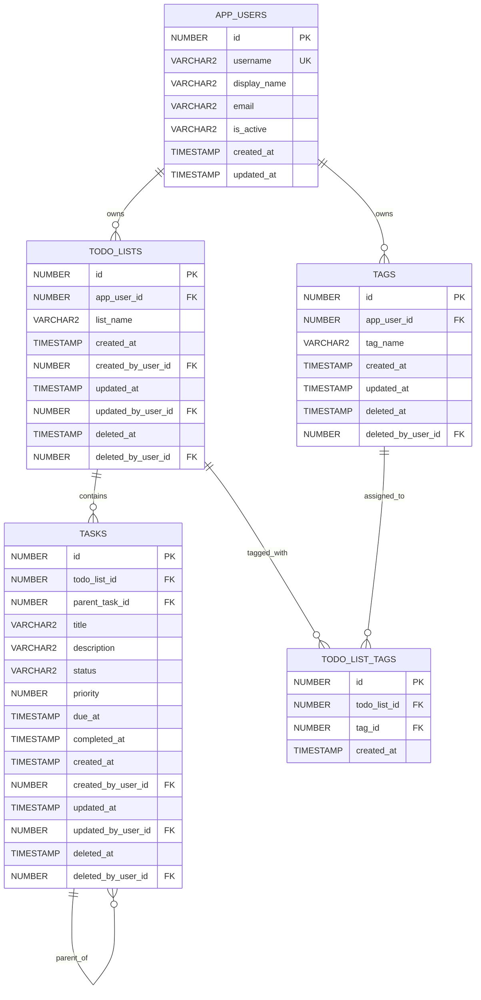

# TaskHub POC - מסמך אפיון טכני

**גרסה:** 3.0  
**Database:** Oracle Database 19c+  
**Future UI:** Oracle APEX  
**Implementation target:** Codex CLI + Oracle SQLcl MCP  
**Purpose:** Proof of Concept בלבד

---

## 1. מטרת המערכת

`TaskHub` היא מערכת POC קטנה לניהול רשימות משימות.

לכל משתמש אפליקטיבי יהיו מספר `To-Do Lists`.  
לכל רשימה יהיו מספר `Tags`.  
בכל רשימה יהיו `Tasks`, כאשר Task יכול להכיל Subtasks עד עומק של 3 רמות מתחת ל-Task הראשי.

המטרה המרכזית של ה-POC היא לבדוק:

- יצירת Data Model באמצעות **Oracle APEX Quick SQL**.
- מימוש API ב-PL/SQL.
- הפרדה אבטחתית מלאה בין Data Owner, Code/API Owner ו-Application Schema.
- שימוש ב-Oracle Application Context לצורך זיהוי המשתמש.
- חשיפת נתונים לקריאה דרך Views בלבד.
- Soft Delete ו-Purge חודשי.
- יכולת של Codex לממש, לבדוק ולבנות מחדש את המערכת בשלבים מתוך Git בלבד לאחר bootstrap ידני של סביבת המעבדה.

---

# 2. ארכיטקטורה

## 2.1 שלושה Schemas

ה-POC משתמש בשלושה Schemas נפרדים כדי ליצור Security Separation אמיתי בין הנתונים, הקוד האפליקטיבי וה-Application Schema.

### `TASKHUB_OWNER`

זהו ה-Data Owner בלבד.

הוא יהיה הבעלים של:

- Tables
- Primary Keys, Foreign Keys, Unique ו-Check Constraints
- Indexes
- Identity Columns והאובייקטים הפנימיים הנלווים להם
- `COMMENT ON TABLE`
- `COMMENT ON COLUMN`

`TASKHUB_OWNER` אינו מכיל את ה-API האפליקטיבי ואינו מקבל הרשאות APEX.

### `TASKHUB_API`

זהו ה-Code/API Owner.

הוא יהיה הבעלים של:

- `PKG_TASKHUB_CONTEXT_CORE`
- `PKG_TASKHUB_CONTEXT`
- `PKG_TASKHUB_TEST_CONTEXT` במעבדת DEV בלבד
- `PKG_TASKHUB_API`
- `PKG_TASKHUB_MAINT`
- `V_TODO_LISTS`
- `V_TODO_LIST_TAGS`
- `V_TASKS`
- `V_TASK_TREE`
- `JOB_TASKHUB_PURGE_MONTHLY`

`TASKHUB_API` יקבל מ-`TASKHUB_OWNER` רק Object Grants מפורשים הדרושים לקומפילציה ולביצוע של הקוד וה-Views. אין להשתמש ב-`SELECT ANY TABLE`, ב-`UPDATE ANY TABLE` או בהרשאות `ANY` דומות.

### `TASKHUB_APP`

זהו ה-Application Schema.

בעתיד הוא יהיה ה-Parsing Schema של Oracle APEX.

ל-`TASKHUB_APP` יהיו רק:

- `EXECUTE` על `TASKHUB_API.PKG_TASKHUB_CONTEXT`
- `EXECUTE` על `TASKHUB_API.PKG_TASKHUB_API`
- `SELECT` על Views מאושרים ב-`TASKHUB_API`

לא יהיו לו הרשאות ישירות על Tables של `TASKHUB_OWNER`.

לא יהיו לו הרשאות על:

- `PKG_TASKHUB_CONTEXT_CORE`
- `PKG_TASKHUB_TEST_CONTEXT`
- `PKG_TASKHUB_MAINT`

## 2.2 Application Context

יוגדר Context Namespace בשם:

```text
TASKHUB_CTX
```

ה-Context ייווצר ידנית על ידי DBA כחלק מ-bootstrap המעבדה ויקושר ל:

```text
TASKHUB_API.PKG_TASKHUB_CONTEXT_CORE
```

ה-Context Namespace עצמו הוא אובייקט בעל הרשאה מערכתית ואינו נוצר על ידי Codex.

## 2.3 גבול האחריות

```text
TASKHUB_APP
    |
    | EXECUTE / SELECT בלבד
    v
TASKHUB_API
    |
    | Object Grants מפורשים בלבד
    v
TASKHUB_OWNER
```

הקמת Oracle container, יצירת שלושת משתמשי ה-Database ויצירת `TASKHUB_CTX` מתבצעות ידנית מחוץ ל-Codex.

לאחר bootstrap זה, כל מימוש האפליקציה חייב להיות ניתן לשחזור מתוך ה-repository בלבד.

# 3. עיקרון האבטחה

## 3.1 APP_USER_ID אינו פרמטר של CRUD

אסור להעביר `APP_USER_ID` כפרמטר לפעולות CRUD.

לדוגמה, API כזה **אינו מותר**:

```plsql
procedure delete_task (
    p_app_user_id in number,
    p_task_id     in number
);
```

הסיבה היא שה-caller יכול לנסות להעביר `APP_USER_ID` של משתמש אחר.

במקום זאת, זהות המשתמש תיקבע פעם אחת עבור ה-request באמצעות:

```text
TASKHUB_CTX.APP_USER_ID
TASKHUB_CTX.APP_USERNAME
```

וה-Package יקרא אותה באמצעות:

```sql
sys_context('TASKHUB_CTX', 'APP_USER_ID')
```

---

## 3.2 למה זה חשוב

ההחלטה הזו היא **Security Requirement**, ולא רק החלטת מימוש.

המטרות הן:

1. למנוע spoofing של `APP_USER_ID`.
2. לרכז Ownership ו-Authorization בתוך בסיס הנתונים.
3. להשתמש באותו מקור זהות עבור ה-Package ועבור ה-Views.
4. למנוע מצב שבו מפתח שוכח להוסיף predicate של משתמש.
5. למנוע גישה לנתונים של משתמש אחר גם במקרה של טעות ב-APEX.

---

# 4. Application Context ו-Identity

יוגדר Context Namespace:

```text
TASKHUB_CTX
```

עם attributes:

```text
APP_USER_ID
APP_USERNAME
```

## 4.1 Trusted Context Package

ה-Context יהיה מקושר ל-Package פנימי:

```text
TASKHUB_API.PKG_TASKHUB_CONTEXT_CORE
```

Package זה הוא ה-trusted setter של `TASKHUB_CTX` ואינו Granted ל-`TASKHUB_APP`.

מטרתו לרכז את הפעולות שמבצעות `DBMS_SESSION.SET_CONTEXT` ו-`DBMS_SESSION.CLEAR_CONTEXT`.

## 4.2 Runtime Facade עבור APEX

Package:

```text
TASKHUB_API.PKG_TASKHUB_CONTEXT
```

יכיל לפחות:

```plsql
procedure init_from_apex;
procedure clear_context;
```

`INIT_FROM_APEX` יקרא:

```sql
sys_context('APEX$SESSION', 'APP_USER')
```

ימפה את שם המשתמש ל-`TASKHUB_OWNER.APP_USERS.ID`, יוודא שהמשתמש פעיל, ורק אז יאתחל את `TASKHUB_CTX` באמצעות ה-Core Package.

`INIT_FROM_APEX` חייב להתחיל ב-clear מפורש של ה-Context כדי למנוע שימוש ב-state שנשאר ב-session קודם.

אם האתחול נכשל, ה-Context חייב להישאר ריק.

בעתיד, כאשר APEX יתווסף, ה-Context יאותחל בכל APEX Request וינוקה בסוף ה-Request.

## 4.3 Test-only Facade עבור Codex/MCP

במעבדת DEV בלבד יוגדר:

```text
TASKHUB_API.PKG_TASKHUB_TEST_CONTEXT
```

עם:

```plsql
procedure init_for_test (
    p_username in varchar2
);

procedure clear_context;
```

`INIT_FOR_TEST` נועד לאפשר בדיקות ללא APEX Session.

הוא חייב:

1. לבצע `clear_context` לפני כל ניסיון אתחול.
2. למצוא את המשתמש לפי `USERNAME` ב-`TASKHUB_OWNER.APP_USERS`.
3. לוודא `IS_ACTIVE = 'Y'`.
4. להגדיר `APP_USER_ID` ו-`APP_USERNAME` רק לאחר validation מלא.
5. להשאיר Context ריק במקרה של כשל.

`TASKHUB_APP` לא יקבל `EXECUTE` על Package זה.

Package זה הוא Lab/Test Artifact ואינו חלק מחבילת Production-like deployment, אלא אם התקבלה החלטה מפורשת אחרת.

## 4.4 Deterministic Context Rule

כל Test וכל פעולת MCP שמסתמכת על Identity חייבים לאתחל Context באופן מפורש באותו flow.

אסור להסתמך על:

- Context שנשאר מהרצה קודמת.
- סדר הרצה של Tests.
- Session reuse של SQLcl או MCP.
- state של Connection Pool עתידי.

אם אין Context תקף:

- פעולת CRUD חייבת להיכשל.
- Views חייבים להחזיר 0 שורות.

# 5. ERD



---

# 6. Quick SQL - כללי עבודה

המודל ייווצר תחילה באמצעות **Oracle APEX Quick SQL**.

Quick SQL הוא ה-source הראשוני ליצירת ה-DDL, אבל ה-DDL שנוצר חייב לעבור review והשלמות על ידי Codex.

## Quick SQL Settings

יש להגדיר ב-Quick SQL:

```text
Primary Key          : Identity Column
Primary Key Name     : ID
Compatibility        : Oracle Database 19c
PL/SQL API           : Off
Date Data Type       : Timestamp
Audit Columns        : Off
```

### למה Audit Columns = Off?

אנחנו רוצים שה-Audit של האפליקציה יתבסס על `TASKHUB_CTX.APP_USER_ID`.

לכן לא נשתמש ב-audit columns האוטומטיים של Quick SQL.

עמודות ה-Audit שלנו מוגדרות במפורש במודל.

### הערה חשובה

אין צורך לכתוב `ID` ב-Quick SQL לכל טבלה.

Quick SQL ייצור את ה-Primary Key `ID` אוטומטית בהתאם ל-setting של Identity Column.

---

# 7. Table: APP_USERS

## 7.1 תפקיד

טבלת המשתמשים האפליקטיביים.

אלה **אינם Oracle Database Users**.

אין Login implementation בתוך בסיס הנתונים ב-POC.

---

## 7.2 Quick SQL

```text
app_users
  username vc128 /nn /unique
  display_name vc200
  email vc320
  is_active vc1 /nn /check Y,N
  created_at timestamp /nn
  updated_at timestamp
```

---

## 7.3 משמעות העמודות

| Column | Purpose |
|---|---|
| `ID` | Primary Key שנוצר על ידי Quick SQL |
| `USERNAME` | שם המשתמש האפליקטיבי |
| `DISPLAY_NAME` | שם תצוגה |
| `EMAIL` | Email אופציונלי |
| `IS_ACTIVE` | `Y` או `N` |
| `CREATED_AT` | זמן יצירה |
| `UPDATED_AT` | זמן עדכון אחרון |

---

## 7.4 כללים

`USERNAME` חייב להיות unique.

משתמש שאינו פעיל:

```text
IS_ACTIVE = 'N'
```

לא יקבל Context פעיל.

ב-POC לא מבצעים Soft Delete ל-`APP_USERS`.

Disable של משתמש נעשה באמצעות:

```text
IS_ACTIVE = 'N'
```

---

# 8. Table: TODO_LISTS

## 8.1 תפקיד

רשימת משימות.

לכל משתמש יכולים להיות מספר Lists.

---

## 8.2 Quick SQL

```text
todo_lists
  app_user_id /fk app_users /nn
  list_name vc200 /nn
  created_at timestamp /nn
  created_by_user_id /fk app_users /nn
  updated_at timestamp
  updated_by_user_id /fk app_users
  deleted_at timestamp
  deleted_by_user_id /fk app_users
```

---

## 8.3 משמעות העמודות

| Column | Purpose |
|---|---|
| `ID` | Primary Key |
| `APP_USER_ID` | Owner של הרשימה |
| `LIST_NAME` | שם הרשימה |
| `CREATED_AT` | זמן יצירה |
| `CREATED_BY_USER_ID` | המשתמש שיצר |
| `UPDATED_AT` | זמן עדכון |
| `UPDATED_BY_USER_ID` | המשתמש שביצע עדכון |
| `DELETED_AT` | Soft Delete timestamp |
| `DELETED_BY_USER_ID` | מי ביצע Soft Delete |

---

## 8.4 Ownership

הבעלות על List נקבעת באמצעות:

```text
TODO_LISTS.APP_USER_ID
```

`PKG_TASKHUB_API` חייב לוודא בכל פעולה:

```text
TODO_LISTS.APP_USER_ID =
TASKHUB_CTX.APP_USER_ID
```

---

# 9. Table: TAGS

## 9.1 תפקיד

Tags של משתמש.

לדוגמה:

```text
Work
Personal
Shopping
Database
Urgent
```

אותו Tag יכול להיות משויך למספר Lists.

---

## 9.2 Quick SQL

```text
tags
  app_user_id /fk app_users /nn
  tag_name vc100 /nn
  created_at timestamp /nn
  created_by_user_id /fk app_users /nn
  updated_at timestamp
  updated_by_user_id /fk app_users
  deleted_at timestamp
  deleted_by_user_id /fk app_users
```

---

## 9.3 Unique Rule

נדרש uniqueness ל-Tag פעיל אצל אותו משתמש.

לוגית:

```text
APP_USER_ID + normalized TAG_NAME
```

ההשוואה תהיה Case Insensitive ותתעלם מרווחים בתחילת ובסוף השם.

מכיוון ש-`TAGS` תומכת ב-Soft Delete, Tag שנמחק לא יחסום יצירה מחדש של אותו שם.

לאחר יצירת ה-DDL באמצעות Quick SQL, Codex ייצור Function-based Unique Index עבור rows פעילים בלבד, לדוגמה:

```sql
create unique index tags_uq1
    on tags (
        case when deleted_at is null then app_user_id end,
        case when deleted_at is null then upper(trim(tag_name)) end
    );
```

ה-Index הסופי חייב לעבור review מול גרסת Oracle שבה רצה המעבדה.

# 10. Table: TODO_LIST_TAGS

## 10.1 תפקיד

טבלת Many-to-Many בין:

```text
TODO_LISTS
```

לבין:

```text
TAGS
```

---

## 10.2 Quick SQL

```text
todo_list_tags
  todo_list_id /fk todo_lists /nn
  tag_id /fk tags /nn
  created_at timestamp /nn
```

---

## 10.3 Unique Rule

אסור לשייך את אותו Tag לאותה List יותר מפעם אחת.

לאחר Quick SQL יש להוסיף:

```sql
alter table todo_list_tags
    add constraint todo_list_tags_uq1
    unique (todo_list_id, tag_id);
```

---

## 10.4 Security Rule

ה-Package חייב לוודא:

```text
TODO_LISTS.APP_USER_ID = TAGS.APP_USER_ID
```

וכן:

```text
APP_USER_ID = TASKHUB_CTX.APP_USER_ID
```

כלומר משתמש לא יכול לצרף Tag שלו ל-List של משתמש אחר, או להפך.

---

# 11. Table: TASKS

## 11.1 תפקיד

אותה טבלה משמשת גם ל:

```text
Task
Subtask
```

אין טבלת `SUBTASKS` נפרדת.

---

## 11.2 Quick SQL

```text
tasks
  todo_list_id /fk todo_lists /nn
  parent_task_id /fk tasks
  title vc200 /nn
  description vc4000
  status vc20 /nn /check OPEN,IN_PROGRESS,DONE,CANCELED
  priority num /nn /check 1,2,3
  due_at timestamp
  completed_at timestamp
  created_at timestamp /nn
  created_by_user_id /fk app_users /nn
  updated_at timestamp
  updated_by_user_id /fk app_users
  deleted_at timestamp
  deleted_by_user_id /fk app_users
```

---

## 11.3 Task מול Subtask

Task ראשי:

```text
PARENT_TASK_ID IS NULL
```

Subtask:

```text
PARENT_TASK_ID = TASKS.ID
```

---

## 11.4 עומק מקסימלי

העומק המותר:

```text
Task                     Level 0
|
+-- Subtask              Level 1
    |
    +-- Subtask          Level 2
        |
        +-- Subtask      Level 3
```

ניסיון ליצור:

```text
Level 4
```

חייב להיכשל.

---

## 11.5 בדיקות Parent

כאשר מתקבל `P_PARENT_TASK_ID`, ה-Package חייב לוודא:

1. ה-Parent קיים.
2. ה-Parent אינו Soft Deleted.
3. ה-Parent שייך לאותו `TODO_LIST_ID`.
4. הרשימה שייכת ל-`TASKHUB_CTX.APP_USER_ID`.
5. הפעולה אינה יוצרת Cycle.
6. העומק החדש אינו גדול מ-3.

---

# 12. Task Status

ערכים מותרים:

```text
OPEN
IN_PROGRESS
DONE
CANCELED
```

כאשר Status הופך ל:

```text
DONE
```

יש לקבוע:

```text
COMPLETED_AT = SYSTIMESTAMP
```

אם `COMPLETED_AT` עדיין `NULL`.

אם Task משתנה מ-`DONE` לסטטוס אחר:

```text
COMPLETED_AT = NULL
```

---

# 13. Priority

ה-Priority נשמר כ-Number.

```text
1 = HIGH
2 = MEDIUM
3 = LOW
```

המטרה היא לאפשר:

```sql
order by priority asc
```

ולקבל:

```text
HIGH
MEDIUM
LOW
```

---

# 14. Audit

ה-Audit האפליקטיבי נקבע מתוך `TASKHUB_CTX` ואינו מתקבל מה-caller.

## 14.1 TODO_LISTS, TAGS, TASKS

שלוש הטבלאות המשתנות על ידי המשתמש האפליקטיבי יכילו:

```text
CREATED_AT
CREATED_BY_USER_ID
UPDATED_AT
UPDATED_BY_USER_ID
DELETED_AT
DELETED_BY_USER_ID
```

הערכים של `*_BY_USER_ID` ייקבעו מתוך:

```sql
sys_context('TASKHUB_CTX', 'APP_USER_ID')
```

## 14.2 APP_USERS

`APP_USERS` היא טבלת זהויות אפליקטיביות ולא חלק מ-CRUD המשתמש הרגיל ב-POC.

לכן היא כוללת בשלב זה:

```text
CREATED_AT
UPDATED_AT
```

ולא `*_BY_USER_ID`.

## 14.3 TODO_LIST_TAGS

Association row כולל בשלב ה-POC:

```text
CREATED_AT
```

ה-POC אינו דורש Audit מלא ברמת Association נפרד, משום שכל שינוי מתבצע דרך API מאובטח ובעלות ה-List וה-Tag נבדקת מול אותו Application User.

# 15. Views

ה-Application Schema לא יקבל `SELECT` ישירות על Tables.

ה-Views יהיו בבעלות:

```text
TASKHUB_API
```

ויוגדרו לפחות:

```text
V_TODO_LISTS
V_TODO_LIST_TAGS
V_TASKS
V_TASK_TREE
```

כל View יהיה:

```text
WITH READ ONLY
```

`TASKHUB_OWNER` יעניק ל-`TASKHUB_API` `SELECT` מפורש על הטבלאות הנדרשות ל-Views.

כל View ב-`TASKHUB_API` יפנה לטבלאות באמצעות שמות מלאים, לדוגמה:

```text
TASKHUB_OWNER.TASKS
TASKHUB_OWNER.TODO_LISTS
```

אין להסתמך על Synonyms לצורך ה-Security Boundary של ה-POC.

`TASKHUB_APP` יקבל `SELECT` רק על ה-Views האלו.

# 16. V_TODO_LISTS

ה-View יחזיר רק Lists של המשתמש הנוכחי.

לוגיקה עקרונית:

```sql
select l.*
from taskhub_owner.todo_lists l
where l.app_user_id =
      to_number(
          sys_context(
              'TASKHUB_CTX',
              'APP_USER_ID'
          )
      )
  and l.deleted_at is null
with read only;
```

## 16.1 V_TODO_LIST_TAGS

ה-View יחזיר רק Associations שבהם:

- ה-List שייך למשתמש הנוכחי ואינו Soft Deleted.
- ה-Tag שייך לאותו משתמש ואינו Soft Deleted.
- ה-Association עצמו קיים.

הלוגיקה חייבת לבדוק גם התאמה בין Owner של ה-List ל-Owner של ה-Tag, גם אם ה-API כבר מונע Association שגוי.

# 17. V_TASKS

ל-`TASKS` אין `APP_USER_ID` ישיר.

ה-Ownership נגזר דרך:

```text
TASKS.TODO_LIST_ID
        |
        v
TODO_LISTS.APP_USER_ID
```

עקרון ה-View:

```sql
select t.*
from taskhub_owner.tasks t
join taskhub_owner.todo_lists l
  on l.id = t.todo_list_id
where l.app_user_id =
      to_number(
          sys_context(
              'TASKHUB_CTX',
              'APP_USER_ID'
          )
      )
  and l.deleted_at is null
  and t.deleted_at is null
with read only;
```

# 18. V_TASK_TREE

`V_TASK_TREE` יספק תצוגה היררכית של Tasks.

הוא יכיל לפחות:

```text
TASK_ID
TODO_LIST_ID
PARENT_TASK_ID
TITLE
STATUS
PRIORITY
TASK_DEPTH
```

כאשר:

```text
TASK_DEPTH = 0..3
```

ניתן לממש באמצעות Oracle hierarchical query:

```text
START WITH
CONNECT BY
```

או recursive subquery factoring אם Codex יעדיף.

# 19. למה לא SQL Macro בשלב הזה

SQL Macro אינו ה-Security Boundary של ה-POC.

ה-Security Boundary יהיה:

```text
Application Context
        +
AUTHID DEFINER Package
        +
Filtered Read-Only Views
```

הסיבה היא שה-caller לא צריך לזכור לקרוא Macro מסוים כדי לקבל Security Filtering.

---

# 20. PKG_TASKHUB_API

ה-Package יהיה:

```text
TASKHUB_API.PKG_TASKHUB_API
```

עם:

```plsql
AUTHID DEFINER
```

---

## 20.1 List API

מינימום:

```plsql
function create_list (
    p_list_name in varchar2
) return number;
```

```plsql
procedure update_list (
    p_list_id   in number,
    p_list_name in varchar2
);
```

```plsql
procedure delete_list (
    p_list_id in number
);
```

---

## 20.2 Tag API

```plsql
procedure add_tag_to_list (
    p_list_id  in number,
    p_tag_name in varchar2
);
```

```plsql
procedure remove_tag_from_list (
    p_list_id  in number,
    p_tag_name in varchar2
);
```

```plsql
procedure delete_tag (
    p_tag_id in number
);
```

אם Tag אינו קיים אצל המשתמש, `ADD_TAG_TO_LIST` יכול ליצור אותו.

`REMOVE_TAG_FROM_LIST` מסיר את ה-Association ב-`TODO_LIST_TAGS`. מאחר של-Association אין Soft Delete בשלב ה-POC, ההסרה יכולה להיות Physical Delete של row הקישור בלבד.

`DELETE_TAG` מבצע Soft Delete ל-Tag עצמו לאחר Ownership check. Associations קיימים יכולים להישאר עד Purge, אך אינם מוצגים ב-Views כאשר ה-Tag Soft Deleted.

## 20.3 Task API

```plsql
function create_task (
    p_list_id        in number,
    p_parent_task_id in number default null,
    p_title          in varchar2,
    p_description    in varchar2 default null,
    p_status         in varchar2 default 'OPEN',
    p_priority       in pls_integer default 2,
    p_due_at         in timestamp default null
) return number;
```

```plsql
procedure update_task (
    p_task_id        in number,
    p_parent_task_id in number,
    p_title          in varchar2,
    p_description    in varchar2,
    p_status         in varchar2,
    p_priority       in pls_integer,
    p_due_at         in timestamp
);
```

```plsql
procedure delete_task (
    p_task_id in number
);
```

---

# 21. Package Security Contract

זהו חלק מחייב מה-SPEC.

`PKG_TASKHUB_API` חייב:

1. לקרוא את `APP_USER_ID` מתוך `TASKHUB_CTX`.
2. להיכשל אם אין Context תקף.
3. לא לקבל `APP_USER_ID` כפרמטר.
4. לבדוק Ownership לפני כל פעולה.
5. לא לחשוף אם ID של משתמש אחר קיים.
6. להשתמש ב-error כללי עבור:
   - ID לא קיים.
   - ID קיים אך שייך למשתמש אחר.
7. לבצע DML רק על rows של המשתמש הנוכחי.
8. לא לבצע `COMMIT`.
9. לא לבצע `ROLLBACK`.
10. להפנות לטבלאות של ה-Data Owner באמצעות שמות מלאים כגון `TASKHUB_OWNER.TASKS`, ולא להסתמך על Synonyms.

Transaction control יהיה באחריות ה-caller.

---

# 22. Soft Delete

Soft Delete יחול ב-POC על:

```text
TODO_LISTS
TASKS
TAGS
```

Soft Delete מתבצע באמצעות:

```text
DELETED_AT
DELETED_BY_USER_ID
```

לדוגמה:

```sql
deleted_at = systimestamp
```

והמשתמש יילקח מ:

```sql
sys_context('TASKHUB_CTX', 'APP_USER_ID')
```

## 22.1 Association Rows

`TODO_LIST_TAGS` לא תבצע Soft Delete עצמאי בשלב ה-POC.

אם List או Tag מסומנים כמחוקים:

- `V_TODO_LIST_TAGS` לא יחזיר את ה-association.
- ה-row ב-`TODO_LIST_TAGS` יכול להישאר עד Physical Purge.

ב-Purge יש למחוק Association Rows לפני מחיקת ה-parent rows שאליהם הם מפנים.

# 23. Delete List

`DELETE_LIST` לא יבצע Physical Delete.

הוא יסמן Soft Delete על:

```text
TODO_LISTS
```

ועל כל Tasks הפעילים תחת הרשימה.

Associations ב-`TODO_LIST_TAGS` אינם צריכים להופיע ב-Views כאשר ה-List נמחק.

---

# 24. Delete Task

`DELETE_TASK` יבצע Soft Delete ל:

```text
Task
+
all descendants
```

כלומר אם נמחק Task אב, גם כל ה-Subtasks תחתיו יסומנו כמחוקים.

---

# 25. Monthly Purge

יוגדר Package:

```text
TASKHUB_API.PKG_TASKHUB_MAINT
```

עם procedure:

```plsql
procedure purge_deleted;
```

ויוגדר Job בבעלות `TASKHUB_API`:

```text
JOB_TASKHUB_PURGE_MONTHLY
```

באמצעות:

```text
DBMS_SCHEDULER
```

## 25.1 Retention

Physical Delete מותר רק כאשר:

```sql
deleted_at <
    systimestamp - interval '30' day
```

כלומר הנתונים יישמרו לפחות 30 יום.

מכיוון שה-Job רץ אחת לחודש, בפועל נתונים מסוימים עשויים להישמר יותר מ-30 יום.

## 25.2 Purge Order

ה-Purge חייב לכבד את יחסי ה-FK וה-self-FK.

סדר עקרוני:

1. להסיר `TODO_LIST_TAGS` שמצביעים על List או Tag שמותר למחוק פיזית.
2. למחוק Tasks צאצאים לפני Tasks הורים, או להשתמש באלגוריתם שמבטיח שאין הפרת self-FK.
3. למחוק Tasks השייכים ל-Lists שמותר למחוק.
4. למחוק Lists שמותר למחוק.
5. למחוק Tags שמותר למחוק ושאין להם Associations שנותרו.

Codex חייב להוכיח את סדר ה-Purge באמצעות Positive ו-Negative Tests לפני שה-Job נחשב מוכן.

# 26. Indexes

לאחר יצירת ה-DDL מ-Quick SQL יש להוסיף לפחות:

```sql
create index todo_lists_ix1
    on todo_lists (
        app_user_id,
        deleted_at
    );
```

```sql
create index tasks_ix1
    on tasks (
        todo_list_id,
        deleted_at
    );
```

```sql
create index tasks_ix2
    on tasks (
        parent_task_id
    );
```

```sql
create index tasks_ix3
    on tasks (
        status,
        priority,
        due_at
    );
```

```sql
create unique index tags_uq1
    on tags (
        case when deleted_at is null then app_user_id end,
        case when deleted_at is null then upper(trim(tag_name)) end
    );
```

ה-Unique Constraint על:

```text
TODO_LIST_TAGS(TODO_LIST_ID, TAG_ID)
```

מכסה גישה לפי `TODO_LIST_ID` כעמודה מובילה.

Codex חייב לבדוק האם נדרש גם Index נפרד על:

```text
TODO_LIST_TAGS(TAG_ID)
```

בהתאם ל-Queries ול-Purge שנממש. אין להוסיף Index רק מתוך הרגל ללא Query שמצדיק אותו.

כל Index חייב להיות מתועד עם ה-Query או ה-Constraint שהוא משרת.

# 27. Grants

ההרשאות הן חלק מ-Security Contract מחייב.

## 27.1 Grants מ-`TASKHUB_OWNER` ל-`TASKHUB_API`

`TASKHUB_API` יקבל Object Grants ישירים בלבד, משום ש-Definer-rights PL/SQL ו-Views חייבים להסתמך על הרשאות מפורשות ולא על Roles.

לכל הפחות:

```text
APP_USERS       : SELECT
TODO_LISTS      : SELECT, INSERT, UPDATE, DELETE
TAGS            : SELECT, INSERT, UPDATE, DELETE
TODO_LIST_TAGS  : SELECT, INSERT, UPDATE, DELETE
TASKS           : SELECT, INSERT, UPDATE, DELETE
```

אין לתת `WITH GRANT OPTION`.

אין לתת Privileges מסוג `ANY`.

## 27.2 Grants מ-`TASKHUB_API` ל-`TASKHUB_APP`

`TASKHUB_APP` יקבל:

```sql
grant execute
on taskhub_api.pkg_taskhub_context
 to taskhub_app;
```

```sql
grant execute
on taskhub_api.pkg_taskhub_api
 to taskhub_app;
```

```sql
grant select on taskhub_api.v_todo_lists     to taskhub_app;
grant select on taskhub_api.v_todo_list_tags to taskhub_app;
grant select on taskhub_api.v_tasks          to taskhub_app;
grant select on taskhub_api.v_task_tree      to taskhub_app;
```

`TASKHUB_APP` לא יקבל `EXECUTE` על:

```text
PKG_TASKHUB_CONTEXT_CORE
PKG_TASKHUB_TEST_CONTEXT
PKG_TASKHUB_MAINT
```

אסור לבצע Grant ישיר מ-`TASKHUB_OWNER` ל-`TASKHUB_APP` על Tables.

דוגמאות אסורות:

```sql
grant select on taskhub_owner.tasks to taskhub_app;
```

```sql
grant insert, update, delete
on taskhub_owner.tasks
 to taskhub_app;
```

# 28. Full Quick SQL Model

הבלוק הבא הוא ה-Quick SQL המלא שניתן לתת ל-Codex או להדביק ב-APEX Quick SQL.

```text
app_users
  username vc128 /nn /unique
  display_name vc200
  email vc320
  is_active vc1 /nn /check Y,N
  created_at timestamp /nn
  updated_at timestamp

todo_lists
  app_user_id /fk app_users /nn
  list_name vc200 /nn
  created_at timestamp /nn
  created_by_user_id /fk app_users /nn
  updated_at timestamp
  updated_by_user_id /fk app_users
  deleted_at timestamp
  deleted_by_user_id /fk app_users

tags
  app_user_id /fk app_users /nn
  tag_name vc100 /nn
  created_at timestamp /nn
  created_by_user_id /fk app_users /nn
  updated_at timestamp
  updated_by_user_id /fk app_users
  deleted_at timestamp
  deleted_by_user_id /fk app_users

todo_list_tags
  todo_list_id /fk todo_lists /nn
  tag_id /fk tags /nn
  created_at timestamp /nn

tasks
  todo_list_id /fk todo_lists /nn
  parent_task_id /fk tasks
  title vc200 /nn
  description vc4000
  status vc20 /nn /check OPEN,IN_PROGRESS,DONE,CANCELED
  priority num /nn /check 1,2,3
  due_at timestamp
  completed_at timestamp
  created_at timestamp /nn
  created_by_user_id /fk app_users /nn
  updated_at timestamp
  updated_by_user_id /fk app_users
  deleted_at timestamp
  deleted_by_user_id /fk app_users
```

---

# 29. Post Quick SQL Checklist

Codex חייב להתייחס ל-Quick SQL כ-bootstrap בלבד.

לאחר generation עליו לבדוק ולהשלים:

- Identity PK לכל טבלה.
- FK constraints.
- Self FK של `TASKS.PARENT_TASK_ID`.
- Check constraints.
- Unique constraint על `TODO_LIST_TAGS`.
- Case-insensitive unique index של Tags פעילים בלבד.
- Indexes שנדרשים בפועל.
- Defaults / audit timestamp logic.
- `COMMENT ON TABLE` לכל Table.
- `COMMENT ON COLUMN` לכל Business Column.
- Views בבעלות `TASKHUB_API`.
- Application Context packages.
- API Packages.
- Explicit Owner-to-API Grants.
- Explicit API-to-App Grants.
- DBMS_SCHEDULER Job.
- Test data.
- Positive tests.
- Negative security tests.
- בדיקות Invalid Objects ו-`USER_ERRORS`.
- בדיקה שאין Unexpected Objects.

אם Quick SQL בגרסה שבה נעשה שימוש אינו מייצר Self-FK תקין עבור:

```text
parent_task_id /fk tasks
```

Codex חייב להשאיר את העמודה שנוצרה ולהוסיף את ה-FK ידנית ב-post-generation DDL.

# 30. Acceptance Criteria

ה-POC נחשב תקין כאשר:

1. `TASKHUB_OWNER` מכיל את Data Objects בלבד לפי הארכיטקטורה המאושרת.
2. `TASKHUB_API` מכיל את ה-Code, ה-Views וה-Maintenance Objects.
3. `TASKHUB_APP` אינו יכול לבצע `SELECT` ישיר מה-Tables של `TASKHUB_OWNER`.
4. `TASKHUB_APP` אינו יכול לבצע DML ישיר על Tables של `TASKHUB_OWNER`.
5. קריאה אפליקטיבית אפשרית רק דרך Views מאושרים ב-`TASKHUB_API`.
6. כתיבה אפליקטיבית אפשרית רק דרך `TASKHUB_API.PKG_TASKHUB_API`.
7. אין `APP_USER_ID` בפרמטרים של CRUD.
8. ללא `TASKHUB_CTX` תקף ה-API נכשל.
9. ללא `TASKHUB_CTX` תקף ה-Views מחזירים 0 rows.
10. כל Test או MCP flow שתלוי ב-Identity מאתחל Context מפורשות ואינו מסתמך על Session State קודם.
11. `TASKHUB_APP` אינו יכול לקרוא ל-`PKG_TASKHUB_TEST_CONTEXT`.
12. משתמש אחד אינו יכול לראות Lists של משתמש אחר.
13. משתמש אחד אינו יכול לראות Tasks של משתמש אחר.
14. משתמש אחד אינו יכול לעדכן או למחוק Task של משתמש אחר.
15. ניסיון לנחש ID של משתמש אחר אינו חושף אם ה-ID קיים.
16. לא ניתן ליצור Association בין List של משתמש אחד ל-Tag של משתמש אחר.
17. ניתן ליצור Subtask עד Level 3.
18. ניסיון ליצור Level 4 נכשל.
19. יצירת Cycle נכשלת.
20. Parent ו-Child חייבים להיות באותה List.
21. `ORDER BY PRIORITY ASC` מחזיר HIGH, MEDIUM, LOW.
22. מעבר ל-`DONE` מעדכן `COMPLETED_AT`.
23. יציאה מ-`DONE` מאפסת `COMPLETED_AT`.
24. Soft Deleted rows אינם מוצגים ב-Views.
25. `DELETE_TAG` מבצע Soft Delete, ה-Tag נעלם מה-Views, ואינו חוסם יצירת Tag פעיל חדש עם אותו normalized name.
26. Purge מוחק פיזית רק מידע שעבר את retention.
27. Purge אינו מפר FK או self-FK.
28. לכל Table ולכל Business Column קיים Data Dictionary Comment.
29. אין Invalid Objects לאחר deployment.
30. כל ה-Grants תואמים במדויק ל-Security Contract.
31. אין Unexpected Direct Grants מ-`TASKHUB_OWNER` ל-`TASKHUB_APP`.
32. המימוש עובד על Oracle Database 19c+ ומאומת בפועל מול גרסת המעבדה.
33. לאחר bootstrap ידני של ה-container, ה-users וה-Application Context, ניתן למחוק את כל Application Objects ולבנות אותם מחדש מתוך Git בלבד.
34. בסיום Milestone מבוצע Clean Rebuild מלא ולאחריו Full Test Suite שעובר בהצלחה.

# 31. סדר עבודה מומלץ ל-Codex

Codex יעבוד Task-by-Task. אין לתת לו את כל ה-POC כמשימה אחת.

לכל Task חייבים להיות מוגדרים מראש:

- Objective.
- Scope.
- Allowed Schemas / Connections.
- Required files.
- Success Criteria.
- Tests.
- Stop Condition.

## Phase 0 - Manual Lab Bootstrap

מתבצע ידנית מחוץ ל-Codex:

- WSL / Docker validation.
- Oracle container clean lab.
- יצירת `TASKHUB_OWNER`, `TASKHUB_API`, `TASKHUB_APP`.
- יצירת `TASKHUB_CTX` באמצעות DBA.
- SQLcl saved connections ייעודיים למעבדה בלבד.
- SQLcl MCP ב-Restrict Level `R4`.

## Phase 1 - Quick SQL / Data Model

Codex יקבל את בלוק ה-Quick SQL וייצר:

- Tables.
- Constraints.
- Indexes.
- Comments.
- Seed data לצורכי test.
- Owner-to-API grants הנדרשים לשלב הבא.

לא להתקדם לפני שה-DDL, מבנה האובייקטים והבדיקות המבניות עוברים בהצלחה.

## Phase 2 - Security Context

לממש:

```text
TASKHUB_API.PKG_TASKHUB_CONTEXT_CORE
TASKHUB_API.PKG_TASKHUB_CONTEXT
TASKHUB_API.PKG_TASKHUB_TEST_CONTEXT
```

ולבדוק:

```text
valid user
inactive user
missing context
deterministic re-initialization
session-state isolation
TASKHUB_APP cannot execute test context package
```

## Phase 3 - Views

לממש ב-`TASKHUB_API`:

```text
V_TODO_LISTS
V_TODO_LIST_TAGS
V_TASKS
V_TASK_TREE
```

ולבדוק isolation בין שני משתמשים, Soft Delete ו-Read Only.

## Phase 4 - API

לממש:

```text
TASKHUB_API.PKG_TASKHUB_API
```

כולל:

- Lists.
- Tags.
- Tasks.
- Subtasks.
- Ownership.
- Hierarchy validation.
- Soft Delete.
- Generic not-found/unauthorized behavior.

## Phase 5 - Maintenance

לממש:

```text
TASKHUB_API.PKG_TASKHUB_MAINT
TASKHUB_API.JOB_TASKHUB_PURGE_MONTHLY
```

ולבדוק retention, purge order ו-FK integrity.

## Phase 6 - Security and Regression Tests

לבדוק במפורש:

```text
cross-user SELECT
cross-user UPDATE
cross-user DELETE
cross-user list/tag association
invalid IDs
missing context
stale context prevention
subtask level 4
task cycle
direct table privilege denial
unapproved package privilege denial
```

## Phase 7 - Clean Rebuild Gate

לאחר Milestone:

1. לשמור Evidence של ה-state התקין.
2. לבצע Reset של Application Objects לפי Runbook.
3. לבנות מחדש מתוך Git בלבד לאחר ה-bootstrap הידני המאושר.
4. להריץ Full Test Suite.
5. להשוות Object/Grant/Test manifests ל-expected state.
6. רק לאחר PASS לסמן את ה-Milestone כ-DONE.

## Phase 8 - Manual Deployment Package

Codex ייצר Deployment Scripts שניתנים להרצה ידנית מחוץ למעבדה.

Codex אינו פורס ל-QA.

ה-DBA מריץ את חבילת ה-deploy ידנית ב-SQLcl רגיל לאחר review.

# 32. Deliverables מ-Codex

Codex אינו יוצר Database Users ואינו מבצע את ה-privileged bootstrap של `TASKHUB_CTX`.

קבצי SQL שמשנים state ימוספרו בקפיצות של 10.

המספור הוא כרונולוגי לפי סדר ההרצה בפועל.

דוגמה ל-sequence ראשוני צפוי, כאשר שמות מדויקים יכולים להשתנות לפי ה-Task:

```text
0010_quick_sql_generated_model.sql
0020_post_quick_sql_constraints.sql
0030_indexes.sql
0040_comments.sql
0050_owner_to_api_grants.sql
0060_seed_data.sql
0100_pkg_taskhub_context_core.pks.sql
0110_pkg_taskhub_context_core.pkb.sql
0120_pkg_taskhub_context.pks.sql
0130_pkg_taskhub_context.pkb.sql
0140_pkg_taskhub_test_context.pks.sql
0150_pkg_taskhub_test_context.pkb.sql
0200_views.sql
0300_pkg_taskhub_api.pks.sql
0310_pkg_taskhub_api.pkb.sql
0400_pkg_taskhub_maint.pks.sql
0410_pkg_taskhub_maint.pkb.sql
0420_scheduler_job.sql
0500_api_to_app_grants.sql
```

Positive, negative ו-structural tests אינם חייבים להיות חלק מ-`db/changes`; הם יישמרו תחת `db/tests` ויורצו שוב ושוב.

בנוסף Codex חייב לשמור canonical end-state source תחת `db/src` ולעדכן אותו יחד עם `db/changes` כדי למנוע Database-only changes.

# 33. Quick SQL כ-Bootstrap

במסמך זה Quick SQL הוא חלק מפורש מה-SPEC.

כל טבלה מוגדרת קודם כל באמצעות Quick SQL.

ה-DDL שנוצר ממנו אינו נחשב final implementation עד ש-Codex מבצע review ומשלים את דרישות האבטחה וה-business rules.

Oracle מתארת את Quick SQL ככלי ליצירה מהירה של מודל relational באמצעות shorthand, כולל יצירת Primary Keys אוטומטיים ו-Foreign Keys באמצעות `/fk` או `/references`.

References:

- Oracle APEX - Creating Data Models with Quick SQL  
  https://docs.oracle.com/en/database/oracle/apex/26.1/apxdc/creating-data-models-quick-sql.html

- Oracle APEX SQL Workshop Guide - Using Quick SQL  
  https://docs.oracle.com/en/database/oracle/apex/26.1/aeutl/using-quick-sql.html

---

# 34. Repository Execution Contract

ה-repository הוא ה-Operating System של המעבדה וה-Source of Truth של המימוש.

## 34.1 Git-first

אסור לבצע DDL או DML משמעותי ב-Database אם ה-SQL המדויק אינו קיים קודם כקובץ תחת:

```text
db/changes/
```

Codex חייב:

1. ליצור או לעדכן Source בקבצים.
2. ליצור numbered change script.
3. להריץ את תוכן ה-script דרך `run-sql` ב-MCP.
4. לבצע verification.
5. לשמור Tests ו-Evidence לפי ה-Task.

## 34.2 R4 Rule

המעבדה מתחילה ב-SQLcl MCP Restrict Level `R4`.

Codex אינו מסתמך על `@` או `@@` דרך MCP.

Codex קורא את קובץ ה-SQL מה-repository ושולח את תוכנו דרך `run-sql`.

לצורך הרצה ידנית, ה-repository יחזיק runner scripts שמשתמשים ב-`@`/`@@` ב-SQLcl רגיל.

## 34.3 Diagnostic SQL

Read-only query חד-פעמי אינו חייב להישמר ב-`db/changes`.

Query שחוזר כחלק מ-verification הופך ל-Test קבוע תחת:

```text
db/tests/
```

## 34.4 No hidden state

אסור שמידע שנדרש לשחזור המערכת יתקיים רק:

- בשיחה עם Codex.
- ב-ChatGPT.
- בתוך Session SQLcl.
- בתוך Database ללא Source מקביל ב-Git.

## 34.5 QA Boundary

Codex אחראי לפיתוח ולבדיקות ב-DEV Lab בלבד.

Codex מייצר Deployment Artifacts, אך QA מופעל ידנית מחוץ למעבדה על ידי אדם.


---

# 35. Official References

- Oracle Database Security Guide - Creating Database Session-Based Application Contexts  
  https://docs.oracle.com/en/database/oracle/oracle-database/19/dbseg/creating-database-session-based-application-contexts1.html

- Oracle Database SQL Language Reference - CREATE CONTEXT  
  https://docs.oracle.com/en/database/oracle/oracle-database/26/sqlrf/CREATE-CONTEXT.html

- Oracle SQLcl - Configuring Restrict Levels for SQLcl MCP Server  
  https://docs.oracle.com/en/database/oracle/sql-developer-command-line/26.2/sqcug/configuring-restrict-levels-sqlcl-mcp-server.html

- Oracle SQLcl MCP Server Tools  
  https://docs.oracle.com/en/database/oracle/sql-developer-command-line/26.2/sqcug/sqlcl-mcp-server-tools.html

- OpenAI Codex MCP documentation  
  https://developers.openai.com/codex/mcp/

---

# End of Specification
